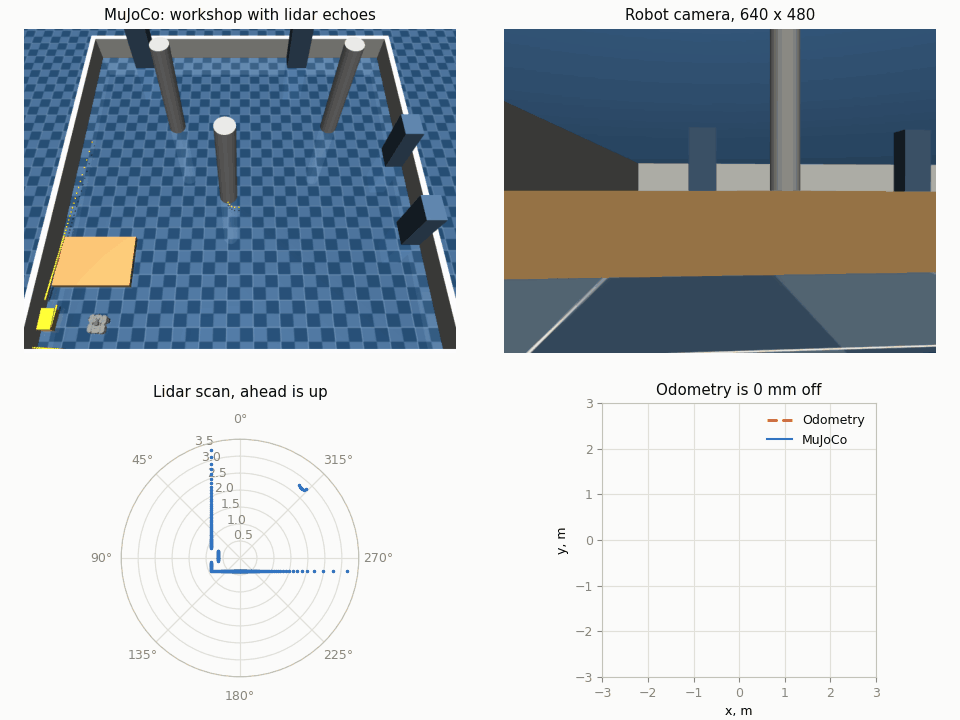

# robocell

## What v0 does

v0 drives a simulated TurtleBot3 Waffle Pi through a 6 by 6 m workshop in
MuJoCo from the keyboard. Its odometry takes the distance from the wheel
encoders and the turn from an integrated gyro, a 360-ray lidar ranges the
room five times a second, a camera renders what the robot sees, and a guard
stops the robot short of anything the lidar sees. Separate windows plot the
route against the ground truth, the latest lidar scan, the camera image and
two maps of the room, by the true pose and by odometry; the viewer marks
every lidar echo, and the console warns when the wheels slip.



A scripted loop at three times the real speed: the workshop with the lidar
echoes, the robot camera, the lidar scan and the route by odometry against
the MuJoCo ground truth.

## Layout

The `robocell_sim` package splits into four worlds, each with its own
`interfaces` and `implementations`:

| Package    | Role                                         | Examples                              |
| ---------- | -------------------------------------------- | ------------------------------------- |
| `hardware` | stands in for the real TurtleBot3            | physics, IMU board, encoders, lidar   |
| `robot`    | would run on a real TurtleBot3 under ROS 2   | kinematics, odometry, slip, safety    |
| `display`  | stands in for RViz and a web console         | route, lidar and camera windows       |
| `ros`      | carries the simulation to ROS 2              | clock, ground truth, joints, TF       |

Nothing under `robot` imports MuJoCo, and a test keeps it that way. Only `ros`
imports ROS message types, so the other worlds test without them; ROS
generates its message modules without types, so `ros` alone suppresses those
type checks, line by line for mypy and by folder for Pylance.
`main.py` wires objects from all four worlds together.

## Run the simulation

`robocell_sim` is an `ament_python` package. Build it with colcon from the
workspace root, then start the TurtleBot3 Waffle Pi in the MuJoCo viewer:

```console
cd /ws
python -m colcon build --symlink-install
source install/setup.bash
ros2 run robocell_sim main.py
```

Run colcon through `python -m` so it uses the virtual environment that holds
MuJoCo; the plain `colcon` command runs the system Python, which does not.
With `--symlink-install`, edits to the code and the models take effect without
a rebuild; only changes to `setup.py`, `setup.cfg` or `package.xml` need one.

Run the tests the same way, or with the strict style gate from the root:

```console
python -m colcon test --packages-select robocell_sim
python -m colcon test-result --verbose
python -m pytest --eo
```

The robot drives in a closed 6 by 6 m workshop centered at the origin, with
four cabinets, three columns, a charging dock on the west wall and a low
pallet that stays under the lidar scan plane. It starts beside the dock,
facing north.

Steer the robot with the keyboard while the viewer window has focus.
Every press changes the speed by one step, up to the robot limits.

| Key            | Action                              |
| -------------- | ----------------------------------- |
| Up / Down      | forward speed one step up or down   |
| Left / Right   | turn one step to the left or right  |
| Enter          | stop                                |
| Space          | pause or resume the simulation      |
| 9              | show or hide the lidar lines        |

Every half second of simulated time the console logs both wheel encoders
in ticks, at 4096 ticks per wheel revolution, as the Dynamixel XM430 counts them.

A second window draws the route of the robot as it drives: the dashed line is
where the wheel encoders and the gyroscope put it, the solid line is where
MuJoCo actually has it, and the title tells how far apart they are in
millimeters. The distance comes from the encoders and the turn from the
gyroscope, whose yaw rate adds up on every physics step.

Every tenth of a second of simulated time the robot also compares how fast
the encoders and the gyroscope say it turns. When the two rates differ by
more than 0.3 rad/s, the wheels slip: the console logs a warning, the route
window marks the spot on the dashed line with a red cross, and the console
logs again once the wheels grip.

A third window shows what the robot camera sees, 640 by 480 pixels thirty
times a second. MuJoCo renders it in a process of its own from the joint
positions the simulation sends, so a slow window drops frames instead of
slowing the robot down. At start the console logs the camera matrix of this
ideal pinhole camera, computed from its vertical field of view, with no
lens distortion.

A fourth window draws the lidar scan five times a second on a polar chart,
with ahead at the top. The lidar casts 360 level rays from the scanner, one
per degree counterclockwise from ahead as in ROS, and keeps ranges between
0.12 and 3.5 m; the low pallet stays under its scan plane, so only the camera
sees it.

The MuJoCo viewer marks every lidar echo with a yellow dot, repainted with
each scan, and the 9 key adds red lines from the scanner to the dots.

The robot refuses to drive into what the lidar sees. While any echo lies in a
corridor 0.3 m ahead of the scanner and 0.2 m to each side, the forward speed
drops to zero, and an echo in the same corridor behind blocks reversing.
Turning in place stays free, so you can steer away. The low pallet stays
under the scan plane, so the robot can still bump into it.

A fifth window piles the lidar scans up into two maps of the workshop, once a
second: on the left by the true pose from MuJoCo, on the right by the pose the
odometry reckons. While the odometry holds, both show the same plan; when the
robot bumps into the pallet and the wheels spin in place, the right map smears
the walls along the way the encoders think the robot went.

After every physics step the simulator publishes to ROS 2 from a node named
`sim`. The `/clock` topic carries the simulated time as `rosgraph_msgs/Clock`,
so nodes with `use_sim_time` follow the simulation and stop while it pauses.
The `/ground_truth/odom` topic carries where MuJoCo truly has `base_link` as
`nav_msgs/Odometry`: the pose in the `world` frame and the twist in the frame
of the robot, stamped with the simulated time.

```console
ros2 topic echo --once /clock
ros2 topic echo --once /ground_truth/odom
```

The `/joint_states` topic carries the wheel angles as `sensor_msgs/JointState`.
It counts them from whole encoder ticks, the way the motor driver will report
them over CAN, rather than from the exact MuJoCo joints. The `/tf` topic carries
`odom → base_footprint` as `tf2_msgs/TFMessage`. The footprint lies on the floor
under `base_link` and keeps only its heading, so `robot_state_publisher` alone
lifts `base_link` 0.01 m above it, as the URDF says. This transform comes from
the true pose in MuJoCo and is a temporary bridge, which the odometry of the
robot will replace. Both topics stamp their headers with the simulated time, so
a lidar scan and the pose it was taken from line up while the robot turns.

```console
ros2 topic echo --once /joint_states
ros2 run tf2_ros tf2_echo odom base_scan
```

## Watch the robot in RViz

One launch file starts the simulator, `robot_state_publisher` with the URDF from
`models/waffle_pi` and RViz with a saved view, all on simulated time:

```console
ros2 launch robocell_sim workshop.launch.xml
```

RViz shows the Waffle Pi in the `odom` frame with its TF axes, and its wheels
turn along with the wheels in MuJoCo. Steer it with the arrow keys in the
viewer, or from a second terminal with `teleop_twist_keyboard` on `/cmd_vel`.
