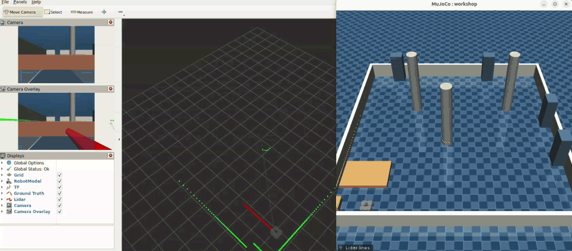
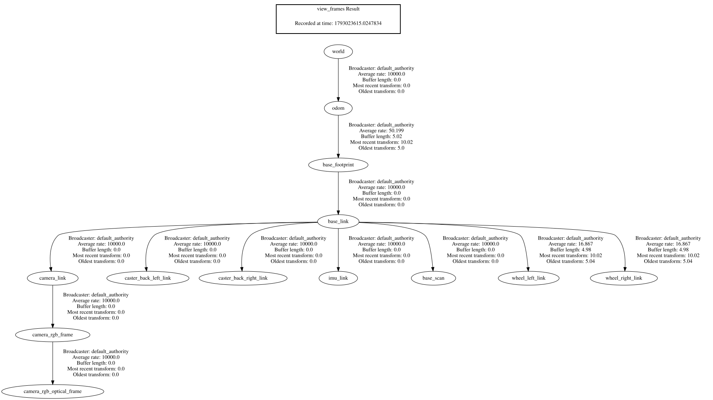

# robocell

## What v0 does

v0 drives a simulated TurtleBot3 Waffle Pi through a 6 by 6 m workshop in
MuJoCo from the keyboard. Its odometry takes the distance from the wheel
encoders and the turn from an integrated gyro, a 360-ray lidar ranges the
room five times a second, a camera renders what the robot sees, and a guard
stops the robot short of anything the lidar sees. Separate windows plot the
route against the ground truth, the latest lidar scan, the camera image and
two maps of the room, by the true pose and by odometry; the viewer marks
every lidar echo, and the console warns when the wheels slip.


A scripted loop at three times the real speed: the workshop with the lidar
echoes, the robot camera, the lidar scan and the route by odometry against
the MuJoCo ground truth.

## What v0.5 does

v0.5 puts the simulator on ROS 2, so the rest of a robot stack can talk to it
the way it will talk to the real Waffle Pi. One node publishes the simulated
clock, the true pose, the wheel joints, the footprint in TF, the lidar scan
and the camera picture with its calibration, each at its own rate in simulated
time, and takes velocity commands on `/cmd_vel`. One launch file adds the URDF,
a fixed `world` frame and an RViz view with the robot model, its frames, the
true pose, the lidar echoes and the camera picture with the scene drawn over
it. Every stand-in for real hardware is listed under
[Temporary bridges](#temporary-bridges) with what replaces it.



RViz on the left and the MuJoCo viewer on the right, both following one drive
through the workshop: the camera picture and the same picture with the scene
drawn over it, the lidar echoes in green and the true pose as a red arrow.

## Layout

The `robocell_sim` package splits into four worlds. Each world keeps all its
interfaces in one `interfaces` folder and sorts its `implementations` into one
folder per device or subject:

| Package    | Role                                       | Implementations                                        |
| ---------- | ------------------------------------------ | ------------------------------------------------------ |
| `hardware` | stands in for the real TurtleBot3          | `physics`, `imu`, `can`, `wheels`, `lidar`, `camera`   |
| `robot`    | would run on a real TurtleBot3 under ROS 2 | `drive`, `command`, `odometry`, `lidar`                |
| `display`  | stands in for RViz and a web console       | `route`, `lidar`, `maps`, `camera`                     |
| `ros`      | carries the simulation to ROS 2            | `wiring`, `clock`, `pose`, `wheels`, `lidar`, `camera` |

For example, the `Imu` interface lives in `hardware/interfaces`, while
`hardware/implementations/imu` holds `Sensed`, which reads it from MuJoCo, and
`Emulated`, the board that sends it on CAN.

Nothing under `robot` imports MuJoCo, and a test keeps it that way. Only `ros`
imports ROS message types, so the other worlds test without them; ROS
generates its message modules without types, so `ros` alone suppresses those
type checks, line by line for mypy and by folder for Pylance.
`main.py` wires objects from all four worlds together.

## Run the simulation

The simulator sends the readings of its IMU board on the virtual CAN bus
`vcan0`, and stops at start if that bus is missing. Install the systemd unit
from `docker/vcan0.service` on the host once, from the workspace root, and it
brings `vcan0` up on every boot:

```console
sudo cp docker/vcan0.service /etc/systemd/system/
sudo systemctl daemon-reload
sudo systemctl enable --now vcan0.service
```

The unit loads the `vcan` module, adds `vcan0` unless it is already there and
sets it up; `sudo systemctl stop vcan0` deletes the bus again. Without the
unit, the same three steps bring it up by hand until the next boot:

```console
sudo modprobe vcan
sudo ip link add dev vcan0 type vcan
sudo ip link set up vcan0
```

The dev container shares the network of the host through `network_mode: host`
in `compose.yaml`, so it sees `vcan0` as soon as the host brings it up.

`robocell_sim` is an `ament_python` package. Build it with colcon from the
workspace root, then start the TurtleBot3 Waffle Pi in the MuJoCo viewer:

```console
cd /ws
python -m colcon build --symlink-install
source install/setup.bash
ros2 run robocell_sim main.py
```

Run colcon through `python -m` so it uses the virtual environment that holds
MuJoCo; the plain `colcon` command runs the system Python, which does not.
With `--symlink-install`, edits to the code and the models take effect without
a rebuild; only changes to `setup.py`, `setup.cfg` or `package.xml` need one.

Run the tests the same way, or with the strict style gate from the root:

```console
python -m colcon test --packages-select robocell_sim
python -m colcon test-result --verbose
python -m pytest --eo
```

The robot drives in a closed 6 by 6 m workshop centered at the origin, with
four cabinets, three columns, a charging dock on the west wall and a low
pallet that stays under the lidar scan plane. It starts beside the dock,
facing north.

Steer the robot with the keyboard while the viewer window has focus.
Every press changes the speed by one step, up to the robot limits.

| Key            | Action                              |
| -------------- | ----------------------------------- |
| Up / Down      | forward speed one step up or down   |
| Left / Right   | turn one step to the left or right  |
| Enter          | stop                                |
| Space          | pause or resume the simulation      |
| 9              | show or hide the lidar lines        |

Every half second of simulated time the console logs both wheel encoders
in ticks, at 4096 ticks per wheel revolution, as the Dynamixel XM430 counts them.

A second window draws the route of the robot as it drives: the dashed line is
where the wheel encoders and the gyroscope put it, the solid line is where
MuJoCo actually has it, and the title tells how far apart they are in
millimeters. The distance comes from the encoders and the turn from the
gyroscope, whose yaw rate adds up on every physics step.

Every tenth of a second of simulated time the robot also compares how fast
the encoders and the gyroscope say it turns. When the two rates differ by
more than 0.3 rad/s, the wheels slip: the console logs a warning, the route
window marks the spot on the dashed line with a red cross, and the console
logs again once the wheels grip.

A third window shows what the robot camera sees, 640 by 480 pixels thirty
times a second. MuJoCo renders it in a process of its own from the joint
positions the simulation sends, so a slow window drops frames instead of
slowing the robot down. At start the console logs the camera matrix of this
ideal pinhole camera, computed from its vertical field of view, with no
lens distortion.

A fourth window draws the lidar scan five times a second on a polar chart,
with ahead at the top. The lidar casts 360 level rays from the scanner, one
per degree counterclockwise from ahead as in ROS, and keeps ranges between
0.12 and 3.5 m; the low pallet stays under its scan plane, so only the camera
sees it.

The MuJoCo viewer marks every lidar echo with a yellow dot, repainted with
each scan, and the 9 key adds red lines from the scanner to the dots.

The robot refuses to drive into what the lidar sees. While any echo lies in a
corridor 0.3 m ahead of the scanner and 0.2 m to each side, the forward speed
drops to zero, and an echo in the same corridor behind blocks reversing.
Turning in place stays free, so you can steer away. The low pallet stays
under the scan plane, so the robot can still bump into it.

A fifth window piles the lidar scans up into two maps of the workshop, once a
second: on the left by the true pose from MuJoCo, on the right by the pose the
odometry reckons. While the odometry holds, both show the same plan; when the
robot bumps into the pallet and the wheels spin in place, the right map smears
the walls along the way the encoders think the robot went.

The simulator also plays the IMU board of the robot. A hundred times a second
of simulated time, the board reads the gyro and the accelerometer on the `imu`
site, which sits where the URDF puts `imu_link`, and sends one measurement on
`vcan0` as two classic CAN frames: `0x101` with the angular velocity and
`0x102` with the linear acceleration, gravity included. Both frames carry the
same measurement number, which counts up from the start and wraps after 255.
[docs/protocols/imu.md](docs/protocols/imu.md) describes the frames byte by
byte; `candump` from `can-utils` shows them as they go out:

```console
candump -td vcan0
```

At rest the accelerometer frame ends in about `52 26 xx 00`, 9.81 m/s² up,
and the gyro frame reads about zero; turning left in place makes the z bytes of
the gyro frame, bytes 4 and 5, a positive number that grows with the turn rate.

The simulator publishes to ROS 2 from a node named `sim`, each topic at its own
rate in simulated time: `/clock` at 100 Hz, the camera at 29.4 Hz, `/scan` at
5 Hz and the rest at 50 Hz. The `/clock` topic carries the simulated time as
`rosgraph_msgs/Clock`, so nodes with `use_sim_time` follow the simulation and
stop while it pauses.
The `/ground_truth/odom` topic carries where MuJoCo truly has `base_link` as
`nav_msgs/Odometry`: the pose in the `world` frame and the twist in the frame
of the robot, stamped with the simulated time.

```console
ros2 topic echo --once /clock
ros2 topic echo --once /ground_truth/odom
```

The `/joint_states` topic carries the wheel angles as `sensor_msgs/JointState`.
It counts them from whole encoder ticks, the way the motor driver will report
them over CAN, rather than from the exact MuJoCo joints. The `/tf` topic carries
`odom → base_footprint` as `tf2_msgs/TFMessage`. The footprint lies on the floor
under `base_link` and keeps only its heading, so `robot_state_publisher` alone
lifts `base_link` 0.01 m above it, as the URDF says. This transform comes from
the true pose in MuJoCo and is a temporary bridge, which the odometry of the
robot will replace. Both topics stamp their headers with the simulated time, so
a lidar scan and the pose it was taken from line up while the robot turns.

```console
ros2 topic echo --once /joint_states
ros2 run tf2_ros tf2_echo odom base_scan
```

The `/scan` topic carries the 360 lidar rays as `sensor_msgs/LaserScan` in the
`base_scan` frame, counterclockwise from ahead one degree apart, from 0.12 to
3.5 m, with `inf` where no echo comes back, as the LDS of the real TurtleBot3
reports them.

```console
ros2 topic echo --once /scan
```

The `/camera/image_raw` topic carries what `camera_rgb` sees as an `rgb8`
`sensor_msgs/Image` of 640 by 480 pixels, sent best effort like any video, and
`/camera/camera_info` carries its ideal pinhole as `sensor_msgs/CameraInfo`,
with no distortion. Both lie in `camera_rgb_optical_frame`. The step count
rounds 1/30 s to 17 physics steps, so the camera runs at 29.4 Hz rather than 30.

```console
ros2 topic hz /camera/image_raw
ros2 topic echo --once /camera/camera_info
```

## Watch the robot in RViz

One launch file starts the simulator, `robot_state_publisher` with the URDF from
`models/waffle_pi`, a static transform that fixes `odom` in the MuJoCo `world`
and RViz with a saved view, all on simulated time:

```console
ros2 launch robocell_sim workshop.launch.xml
```

RViz shows the Waffle Pi in the `world` frame with its TF axes, and its wheels
turn along with the wheels in MuJoCo. A red arrow marks the true pose from
`/ground_truth/odom`, green squares mark the lidar echoes from `/scan`, one
panel shows the picture from `/camera/image_raw`, and another draws the lidar,
the frames and the robot over that picture at half opacity, so the echoes land
on the walls the camera sees. Steer it with the arrow keys in the viewer, or
from a second terminal with `teleop_twist_keyboard` on `/cmd_vel`.

## ROS 2 reference

### Topics

Rates count in simulated time. QoS is what `ros2 topic info -v` reports for
the publisher, or for the subscription on `/cmd_vel`.

| Topic                 | Type                     | Rate          | QoS                              | Why this QoS                                                                                                   |
| --------------------- | ------------------------ | ------------- | -------------------------------- | -------------------------------------------------------------------------------------------------------------- |
| `/clock`              | `rosgraph_msgs/Clock`    | 100 Hz        | reliable, keep last 10           | Timers of every `use_sim_time` node step on it; the message is tiny, so delivery costs nothing.                |
| `/ground_truth/odom`  | `nav_msgs/Odometry`      | 50 Hz         | reliable, keep last 10           | It is the reference that estimates are judged against, so a gap would skew the error.                         |
| `/tf`                 | `tf2_msgs/TFMessage`     | 50 Hz, ≤ 20 Hz | reliable, keep last 10 and 100   | TF buffers interpolate between transforms, and a missing one breaks lookups; the wheels come from `robot_state_publisher` at its own 20 Hz cap. |
| `/tf_static`          | `tf2_msgs/TFMessage`     | once          | reliable, transient local        | Fixed frames go out once, so a node that starts late must still get them.                                     |
| `/robot_description`  | `std_msgs/String`        | once          | reliable, transient local        | RViz may start after `robot_state_publisher` and still needs the URDF.                                        |
| `/joint_states`       | `sensor_msgs/JointState` | 50 Hz         | reliable, keep last 10           | A small message; reliable publishing also serves `robot_state_publisher`, which subscribes best effort.        |
| `/scan`               | `sensor_msgs/LaserScan`  | 5 Hz          | reliable, keep last 10           | 360 floats at 5 Hz load nothing, and a reliable publisher serves both RViz and best effort readers like Nav2.   |
| `/camera/image_raw`   | `sensor_msgs/Image`      | 29.4 Hz       | best effort, keep last 5         | A frame is 900 KB and only the newest one matters, so a lost frame is skipped rather than resent late.         |
| `/camera/camera_info` | `sensor_msgs/CameraInfo` | 29.4 Hz       | reliable, keep last 10           | Readers pair it with each picture; it is small, and reliable serves readers of either kind.                    |
| `/cmd_vel`            | `geometry_msgs/Twist`    | as sent       | reliable, keep last 10           | A lost command would leave the robot on its last speed, so every one must arrive.                              |

### Frames



The tree above comes from `ros2 run tf2_tools view_frames` against the launch
file; the same tree is in [docs/tf_tree.pdf](docs/tf_tree.pdf).

| Frame                      | Meaning                                                                                                                       |
| -------------------------- | ----------------------------------------------------------------------------------------------------------------------------- |
| `world`                    | The MuJoCo world, fixed forever; the true pose lives here, so truth and every estimate can be compared in it.                  |
| `odom`                     | Where odometry counts from; it moves smoothly and never jumps, but drifts from `world`. Today a static identity pins it to `world`. |
| `base_footprint`           | The robot on the floor: its position and heading, with no height, roll or pitch.                                             |
| `base_link`                | The body of the robot, 0.01 m above the footprint, centered between the wheels.                                              |
| `wheel_left_link`, `wheel_right_link` | The wheels, turned by the angles in `/joint_states`.                                                              |
| `caster_back_left_link`, `caster_back_right_link` | The rear casters, fixed to the body.                                                                  |
| `base_scan`                | The lidar; `/scan` counts its rays counterclockwise from its x axis.                                                          |
| `imu_link`                 | The IMU on the control board; nothing publishes `/imu` yet (#73).                                                            |
| `camera_link`, `camera_rgb_frame` | The camera body and its lens, x forward as on the robot.                                                              |
| `camera_rgb_optical_frame` | The lens in optical axes, z forward, x right and y down, where pictures and their calibration live.                          |

### Temporary bridges

Some topics come straight out of MuJoCo where the real robot will have a driver
or an estimator. Each bridge stays until its successor lands:

| Bridge today                                    | Replaced by                               |
| ----------------------------------------------- | ----------------------------------------- |
| `/cmd_vel` straight into `data.ctrl`            | `motor_driver` over CANopen (week 4)      |
| `/joint_states` from the simulator              | `motor_driver` (week 4)                   |
| TF `odom → base_footprint` from the true pose   | an odometry node (#72), then an EKF       |
| `/scan` straight from `Raycast`                 | `lidar_driver` over UART (week 3)         |
| the camera straight from `Rendered`             | stays, as a simplification of the project |

`/clock` and `/ground_truth/odom` are no bridges: they exist only in the
simulation and simply go away on the real robot.

## Hardware protocols

The emulated boards and their drivers talk over the wire protocols described
in [docs/protocols](docs/protocols):

| Board | Bus                     | Document                                       |
| ----- | ----------------------- | ---------------------------------------------- |
| IMU   | classic CAN, 500 kbit/s | [docs/protocols/imu.md](docs/protocols/imu.md) |
