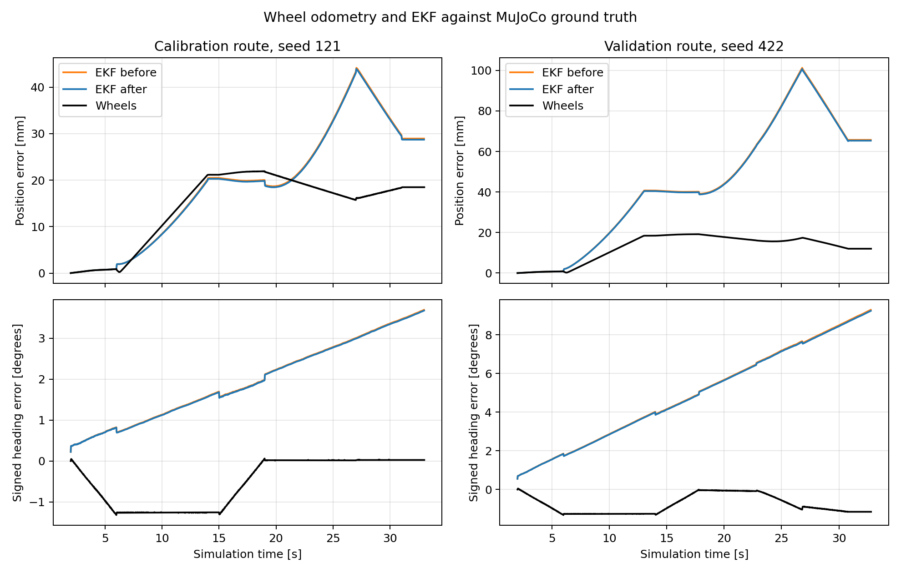

# Position accuracy

How far the reckoned position drifts from the MuJoCo ground truth
as the robot gains sensors, one step per sensor.

| Step | Sensors           | Drift, mm | Commit  | Route                                  |
| ---- | ----------------- | --------- | ------- | -------------------------------------- |
| 1    | encoders          | 205       | d1394b9 | [01-encoders.png](01-encoders.png)     |
| 2    | encoders and gyro | 4         | 867ac25 | [02-gyroscope.png](02-gyroscope.png)   |
| 3    | lidar map         | -         | 8e70b41 | [03-map.png](03-map.png)               |

## 1. Encoders

Dead reckoning from both wheel encoders alone, after a manual drive
of a few loops about one and a half meters across.


## 2. Gyroscope

The encoders still give the distance, but the turn now comes from the gyro,
whose yaw rate adds up on every physics step. The route window still labels
the dashed line as encoders. After a manual drive of loops and figure
eights about one and a half meters across, the reckoned route ends 4 mm
from the ground truth.


## 3. Map by odometry

The lidar scans pile up once a second into two maps of the workshop, on the
left by the true pose from MuJoCo, on the right by the pose the odometry
reckons from the encoders and the gyro. The map by odometry is right for as
long as the odometry holds: with ideal sensors the gyro keeps the heading
within a fraction of a milliradian, so walls, cabinets, columns and the dock
land in the same places on both sides.

It drifts only when the wheels slip. Here the robot ran into the low pallet,
which stays under the lidar scan plane, and pushed against it from the east.
The wheels kept turning, the encoders reckoned the robot moving west, and
every new scan landed further west than the one before: the two columns grow
tails of repeated arcs and the west wall and the dock double. Nothing in the
robot can notice this from its own odometry, which is why v2 needs SLAM to
match each scan against the map and correct the pose.


## 4. Wheel covariances and EKF

The defaults in `odometry.py` are now based on measured wheel velocity
residuals rather than guessed standard deviations. These measurements do
not establish that the EKF is more accurate than wheel odometry: on both
recorded routes, the current biased gyro makes the filtered pose worse.

### Acquisition and alignment

The headless experiment uses the workshop model, its `start` keyframe,
2 ms physics steps, 4096-tick encoders and the production `Jointed` and
`Tracked` publishers. The real `odometry.py` and `ekf_node` run as separate
processes in ROS domain 91. The experiment publishes `/clock` at 100 Hz,
wheel joints and truth at 50 Hz, and IMU measurements at 100 Hz. Physics
is paced against monotonic wall time so the filter can run at 50 Hz.

The IMU uses `Sensed`, `Noisy`, `Gaussian`, `Packed`, `Received`, `Scaled`
and `Inertial`, with the same bias/noise profile as the workshop launch.
CAN encoding and decoding run in process; this experiment does not measure
SocketCAN transport or driver polling latency. It also omits the GUI,
camera and lidar workloads. Commands go directly to the simulated wheel
actuators to make the route reproducible. Every physics step checks for
contact with world geometry other than the floor; all four accepted runs
recorded no obstacle contacts.

Each bag includes `/wheel/odometry`, `/imu`, `/odometry/filtered`,
`/ground_truth/odom`, `/tf`, `/tf_static`, `/clock` and `/joint_states`.
The recorded static transforms match the launch and URDF: `world → odom`
is `(-2.1, -2.5, pi/2)`, `base_footprint → base_link` is 0.01 m up, and
`base_link → imu_link` is another 0.068 m up. The EKF owns the dynamic
`odom → base_footprint` transform.

The analysis uses message header timestamps, not bag arrival timestamps.
It transforms odom poses using the recorded `world → odom` transform,
then interpolates truth at each estimate's time. Heading interpolation
and differences follow the shortest arc through ±pi. No trajectory fit
or endpoint adjustment is applied, and no extrapolation is allowed.
Position errors use x/y only; the fixed vertical footprint offset does
not enter a planar comparison. Both velocity streams are already in robot
axes, with parallel base_link/base_footprint axes in the planar model.
The first two stationary seconds are excluded from all reported metrics.

Wheel velocity is a finite difference over the preceding 20 ms, whereas
truth velocity is instantaneous at the message stamp. The measured
residual therefore includes this timing approximation, encoder
quantization and physical wheel slip during acceleration and turning.
It is an effective covariance for this publisher, not an optical sensor
specification or an assumption of independent white noise.

### Measured covariance

For each aligned wheel sample, compute `wheel_speed - true_speed` and
`wheel_yaw_rate - true_yaw_rate`. Report the signed mean separately and
use population variance, `mean((residual - mean(residual))**2)`, for the
covariance. Do not add the squared bias to that variance.

| Route | Samples | Forward mean, m/s | Forward variance, (m/s)² | Yaw mean, rad/s | Yaw variance, (rad/s)² |
| --- | ---: | ---: | ---: | ---: | ---: |
| Calibration, seed 121 | 1551 | 0.00033766 | 7.13486e-6 | -0.000000973 | 7.85358e-5 |
| Validation, seed 422 | 1541 | 0.00028807 | 4.30905e-6 | -0.00069691 | 1.04504e-4 |

The defaults are the calibration variances rounded to two significant
figures: `linear_variance = 7.1e-6` and `angular_variance = 7.9e-5`.
The old defaults were `1e-4` and `4e-4`. Validation uses a different route
and seed, without refitting. Its variance changes with the maneuvers:
forward variance is about 0.60 times calibration and yaw variance about
1.33 times calibration. These are nominal constants, not guarantees for
all routes, speeds, friction settings or collisions.

### Before and after

Calibration lasts 33 s and includes a right turn before driving east,
a left turn, a northward straight, reverse motion and stops. Turning east
first avoids the pallet immediately north of the initial position.
Validation lasts 32.8 s and changes the straight lengths, turns and adds
an arc. Complete duration/speed/yaw-rate schedules are in `record.py` and
in each recording's `profile.json`.

| Route | Estimate | Position RMS, mm | Final position error, mm | Heading RMS, degrees | Final signed heading error, degrees |
| --- | --- | ---: | ---: | ---: | ---: |
| Calibration | Wheels, either covariance | 16.248 | 18.487 | 0.775 | 0.026 |
| Calibration | EKF, before | 22.996 | 28.953 | 2.188 | 3.695 |
| Calibration | EKF, after | 22.812 | 28.719 | 2.175 | 3.676 |
| Validation | Wheels, either covariance | 14.219 | 12.019 | 0.906 | -1.152 |
| Validation | EKF, before | 52.936 | 65.707 | 5.545 | 9.288 |
| Validation | EKF, after | 52.610 | 65.335 | 5.513 | 9.236 |



The change is small and does not resolve the drift. Each configuration
has one run per route; process scheduling can affect the EKF, so this is
not a statistical claim of improvement. Wheel results are identical
before and after because changing their published covariance does not
change encoder integration.

The injected constant gyro z bias is +0.0019494 rad/s for seed 121 and
+0.0049761 rad/s for seed 422. The reported gyro variance remains `1e-6`;
its bias is not estimated or corrected by this configuration. The
filtered heading drifts consistently with that bias. Covariance
calibration alone cannot remove it. Bias estimation and SLAM remain
separate work.

An initial exploratory route drove straight north into the pallet. Its
wheel position RMS error reached 0.925 m and filtered error 1.184 m.
Those residuals were excluded from calibration: a constant nominal
covariance cannot represent wheels spinning against an obstacle. The
exploratory bag remains under `log/accuracy-121/train-before-ready`.

### Reproduce

From the repository root in the development container, with ROS sourced:

```bash
source install/setup.bash
export PYTHONPATH="$PWD:$PWD/src/robocell_sim${PYTHONPATH:+:$PYTHONPATH}"
recordings=log/accuracy-repeat
python -m docs.accuracy.record "$recordings/train-free-before" \
  --seed 121 --linear 1e-4 --angular 4e-4
python -m docs.accuracy.record "$recordings/validation-free-before" \
  --seed 422 --validation --linear 1e-4 --angular 4e-4
python -m docs.accuracy.record "$recordings/train-free-after" \
  --seed 121 --linear 7.1e-6 --angular 7.9e-5
python -m docs.accuracy.record "$recordings/validation-free-after" \
  --seed 422 --validation --linear 7.1e-6 --angular 7.9e-5
for recording in "$recordings"/*; do
  python -m docs.accuracy.analyze "$recording"
done
python -m docs.accuracy.summarize "$recordings" "$recordings/report"
```

The four runs take about 2 minutes 15 seconds plus discovery and startup.
Use an unused domain with `--domain` if 91 is already occupied. They do not
use `vcan0` or send commands to the workshop GUI. Existing output paths
are refused; choose a fresh directory for another experiment. Subprocess
startup, shutdown and ROS discovery have bounded waits.

`record.py` creates a SQLite rosbag, process logs and `profile.json`.
`analyze.py` writes aligned error CSV files and `metrics.json`.
`summarize.py` creates the figure and a manifest containing the inputs,
metrics and SHA-256 digest of each bag. The checked-in [manifest](04-ekf.json)
identifies the local evidence under `log/accuracy-121`; bags and temporary
results are ignored by Git. Metrics are based on source revision
`9d29a63` with covariance overrides; hardware physics and noise profiles
were unchanged between configurations.

Run the frame/time alignment tests and the project checks with:

```bash
python -m pytest docs/accuracy/test_aligned.py
python -m pytest --eo
```
