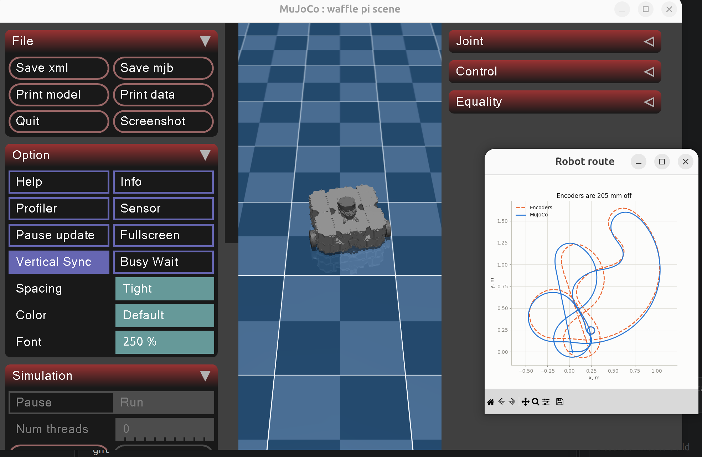
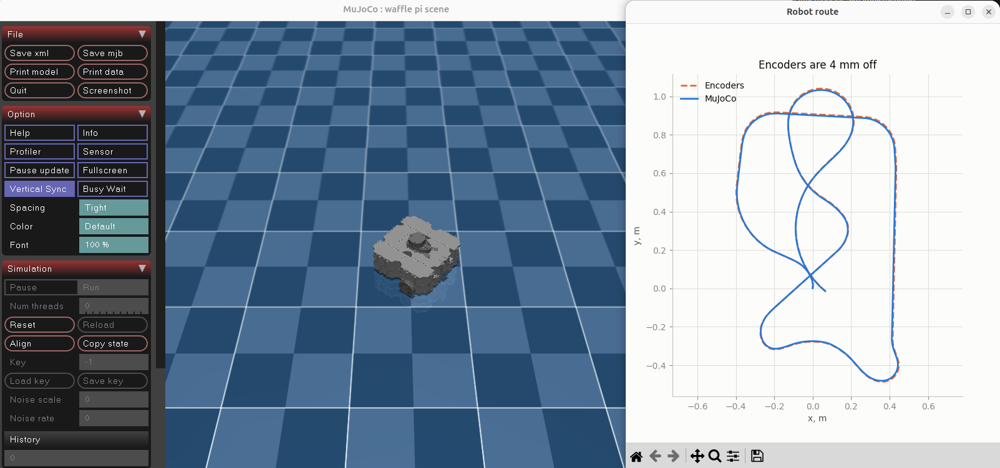
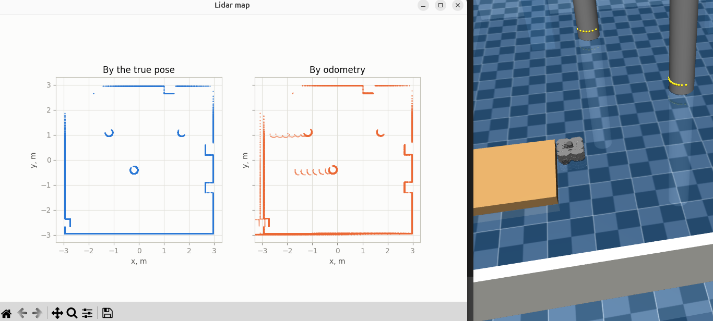

# Position accuracy

How far the reckoned position drifts from the MuJoCo ground truth
as the robot gains sensors, one step per sensor.

| Step | Sensors           | Drift, mm | Commit  | Route                                  |
| ---- | ----------------- | --------- | ------- | -------------------------------------- |
| 1    | encoders          | 205       | d1394b9 | [01-encoders.png](01-encoders.png)     |
| 2    | encoders and gyro | 4         | 867ac25 | [02-gyroscope.png](02-gyroscope.png)   |
| 3    | lidar map         | -         | 8e70b41 | [03-map.png](03-map.png)               |

## 1. Encoders

Dead reckoning from both wheel encoders alone, after a manual drive
of a few loops about one and a half meters across.

## 2. Gyroscope

The encoders still give the distance, but the turn now comes from the gyro,
whose yaw rate adds up on every physics step. The route window still labels
the dashed line as encoders. After a manual drive of loops and figure
eights about one and a half meters across, the reckoned route ends 4 mm
from the ground truth.

## 3. Map by odometry

The lidar scans pile up once a second into two maps of the workshop, on the
left by the true pose from MuJoCo, on the right by the pose the odometry
reckons from the encoders and the gyro. The map by odometry is right for as
long as the odometry holds: with ideal sensors the gyro keeps the heading
within a fraction of a milliradian, so walls, cabinets, columns and the dock
land in the same places on both sides.

It drifts only when the wheels slip. Here the robot ran into the low pallet,
which stays under the lidar scan plane, and pushed against it from the east.
The wheels kept turning, the encoders reckoned the robot moving west, and
every new scan landed further west than the one before: the two columns grow
tails of repeated arcs and the west wall and the dock double. Nothing in the
robot can notice this from its own odometry, which is why v2 needs SLAM to
match each scan against the map and correct the pose.

