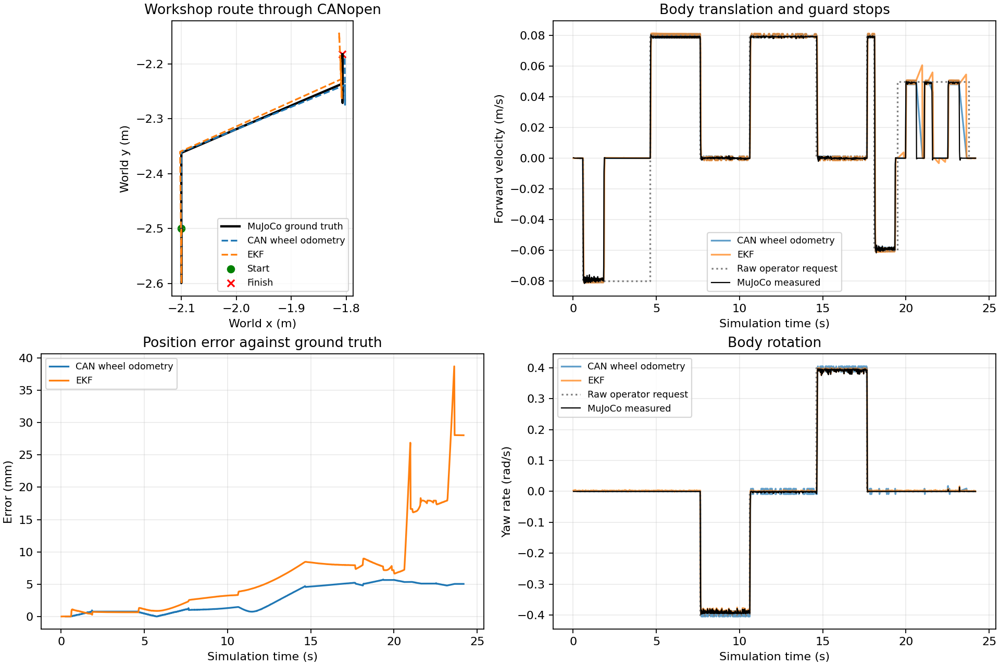

# CANopen workshop verification

The normal `workshop.launch.xml` now runs the wheel emulators in the same
MuJoCo world as the sensors and a separate `motor_driver` ROS node. All
keyboard and ROS body commands pass through the driver-owned collision guard.
Only the emulators assign actuator targets and acquire wheel feedback, and
only `motor_driver` publishes `/joint_states`.

```mermaid
flowchart LR
    Keyboard[Keyboard events] -->|stamped body intent| Guard
    ROS[/cmd_vel] --> Guard
    Lidar[lidar.py /scan] --> Guard
    Guard[Collision guard and original input age] --> Host[motor_driver]
    Host -->|RPDO commands| Drives[CANopen wheel emulators]
    Drives -->|matched PDO snapshots| Host
    Host --> Joints[/joint_states]
    Joints --> Wheels[wheel odometry]
    Wheels --> EKF
    IMU[imu.py /imu] --> EKF
```

## Run

Build and source the ROS workspace, then start the ordinary workshop:

```console
source /opt/ros/jazzy/setup.bash
python -m colcon build --symlink-install --packages-select robocell_sim
source install/setup.bash
ros2 launch robocell_sim workshop.launch.xml
```

`can_interface`, `can_channel`, `left_node` and `right_node` are shared by
simulator and driver; defaults are `socketcan`, `vcan0`, 1 and 2. The launch
enables `collision_guard=true`. The standalone `motors.py` world still uses
an unguarded driver by default because that world has no lidar.

Hold an arrow for key repeat or publish `/cmd_vel` continuously, for example
at 20 Hz. Keyboard events retain their original system-time timestamp on
`/keyboard/cmd_vel`; the driver converts the transport age once to its
monotonic clock. Scan updates never renew command age. Commands expire after
250 ms, and guard measurements expire after 500 ms of simulation time.
Before the first scan, the guard inhibits motion.

Fresh input after a command timeout requests a verified enable, and another
fresh command after enable is required for motion. `/motor_driver/retry`
requests a new connection without fault reset. `/motor_driver/recover`
explicitly permits fault reset. Both use `std_srvs/srv/Trigger` and acknowledge
the request; the transient-local `/motor_driver/state` topic reports its
outcome. Local emulator fault `FF02` still needs its cause fixed and the
emulator restarted.

Space and `/sim/pause` (`std_srvs/srv/SetBool`) share the same pause event.
CAN protection continues on monotonic wall time while the simulation clock
is frozen. On resume, disabled feedback triggers verified enable, discards
cached motion and requires a subsequent fresh command.

## Reproduce the recording

The script launches the actual workshop and its motor, lidar and IMU drivers,
wheel odometry, robot-state publisher and EKF as separate processes. It uses
a fresh ROS domain, a private UART endpoint and wheel IDs 17 and 29. Give it
an otherwise unused SocketCAN channel; it refuses an already active channel.
It requires no Internet and changes no network configuration.

```console
source /opt/ros/jazzy/setup.bash
source install/setup.bash
PYTHONPATH=src/robocell_sim:$PYTHONPATH python docs/canopen/record.py \
  /tmp/robocell-canopen-run --channel vcan0 --seed 121
python docs/canopen/analyze.py /tmp/robocell-canopen-run
ros2 bag info /tmp/robocell-canopen-run/bag
```

`record.py` disables both windows, records all required ROS topics and CAN
frames, runs the checks below, and stops the launch with bounded cleanup.
It pauses its own driver process briefly to exercise the drive-side watchdog
and sends one targeted NMT reset to exercise restart. It never resets a fault
without the explicit recovery service call in the scenario.

The checked-in capture is under [results](results). Restore its ROS bag with:

```console
mkdir -p /tmp/robocell-canopen-capture/bag
cp docs/canopen/results/bag/metadata.yaml /tmp/robocell-canopen-capture/bag/
gzip -dc docs/canopen/results/bag/bag_0.db3.gz > /tmp/robocell-canopen-capture/bag/bag_0.db3
ros2 bag info /tmp/robocell-canopen-capture/bag
```

[checks.json](results/checks.json) records pass/fail evidence, state changes,
EMCY codes and message counts. [can.log.gz](results/can.log.gz) contains
candump-format traffic. [route.csv.gz](results/route.csv.gz) contains truth,
wheel and EKF poses and velocities; [launch.log.gz](results/launch.log.gz)
contains the actual process logs. The bag contains `/cmd_vel`, keyboard intent,
`/joint_states`, `/scan`, `/imu`, `/wheel/odometry`, `/odometry/filtered`,
`/ground_truth/odom`, `/clock`, driver state, TF and static TF.

## Recorded results

The seed-121 capture ran for 27.64 wall seconds, covering 24.16 seconds of
simulated motion and 0.854 m of measured travel. It includes forward travel,
reverse, both turns, an intentional guard stop against the south wall and
fault/recovery checks in free space. All 15 checks passed.

| Check | Observed result |
| --- | --- |
| Joint feedback ownership | One publisher, `motor_driver` |
| Keyboard collision guard | Requested reverse speed -0.08 m/s; both drive targets and measured wheel speeds reached zero before the wall |
| Application timeout | Host quick-stopped both drives after input expired; measured body speed was below 0.00002 m/s |
| Fresh input after timeout | Full enable repeated and measured motion resumed with fresh input |
| Pause | `/clock` held at 20.610 s, both targets stayed zero, host remained available |
| Resume | Disabled state caused verified enable before fresh motion |
| Drive command watchdog | Both drives latched `FF01`; measured delays were 200.09 and 200.10 ms from the last command, and both measured wheel speeds reached zero |
| Retry without reset permission | Both `FF01` faults remained latched |
| Explicit recovery | Faults cleared, targets stayed zero until a new post-enable command, then measured forward motion resumed |
| One-drive NMT restart | Host stopped both drives and invalidated the old feedback epoch |
| Retry after restart | Verified enable completed with zero targets and no cached motion |
| Clean shutdown | Zero-target quick-stop `0002`, then disable-voltage `0000`, reached both CAN node IDs |

The bag contains 11,632 ROS messages, including 1,103 CAN-derived joint
measurements and wheel-odometry outputs and 1,209 EKF outputs. Protective
pause behavior is also tested at the actual MuJoCo actuator boundary in
`test_running.py`; the host/emulator tests verify command expiry and faults
against real virtual-CAN endpoints and MuJoCo shafts.



The plot transforms wheel/EKF coordinates into the workshop frame using the
existing initial pose: `world_x = -2.1 - odom_y`, `world_y = -2.5 + odom_x`.
Errors use interpolated ground-truth positions at each acquisition time.

| Estimate | Position RMSE | Maximum error | Final error |
| --- | ---: | ---: | ---: |
| CAN wheel odometry | 3.25 mm | 5.73 mm | 5.04 mm |
| EKF | 9.39 mm | 38.71 mm | 28.05 mm |

This run includes feedback gaps during verified reconfiguration. The EKF
continues predicting across those gaps, so its error grows during recovery;
it also retains the existing gyro-bias limitation. These measurements verify
integration and expose that behavior. A separate localization task should
choose the estimator policy for feedback outages before changing its tuning.
They are not a new covariance calibration.

The existing low pallet remains below the lidar plane. An exploratory route
reached it and produced wheel slip and growing odometry error, as the existing
model predicts. The checked-in control route leaves clearance to that pallet;
the intentional collision-guard check uses a wall the lidar can see. These
software checks exercise synthetic CANopen over SocketCAN `vcan`, without
claiming electrical-CAN timing or a certified emergency stop.
