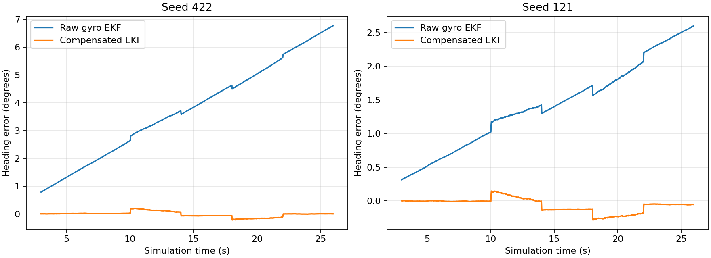

# Stationary gyro calibration

The workshop now preserves raw `/imu` and feeds `/imu/calibrated` to the EKF.
The new `gyro.py` process learns the three-axis constant offset from measured
standstill. It imports neither MuJoCo nor simulator bias values. The emulated
IMU retains its per-run bias and noise.

Leave the robot stationary after launch until `/gyro/state` reports `ready`.
The node needs two continuous seconds of simulated time and at least 100
unique IMU timestamps. Both named wheels must have measured shaft speeds at
most 0.02 rad/s, with feedback no more than 0.1 s old; 20 ms of acquisition
skew is allowed. Acceleration magnitude must be within 0.5 m/s² of gravity.
The gyro must stay below 0.1 rad/s on each axis, with sample deviation at most
0.003 rad/s and no jump above four times that limit. Movement, IMU gaps above
50 ms and unstable windows restart calibration. Duplicate timestamps do not
count, and stale IMU messages do not publish corrected output.

Before calibration, corrected output is withheld and the EKF uses the wheels
alone. Once ready, the offset and its uncertainty stay fixed during motion.
The node copies the original IMU message, subtracts the offset from all three
gyro axes, and adds the estimated mean's variance to the covariance diagonal.
Headers, orientation, acceleration and their covariances retain their original
values. A backwards IMU clock, changed IMU frame or process restart requires a
new stationary interval. Stop the robot and restart `gyro.py` to recalibrate;
there is no automatic adaptation during movement.

```console
ros2 topic echo --once /gyro/state
ros2 topic echo --once /imu/calibrated
ros2 launch robocell_sim workshop.launch.xml gyro_calibration_duration:=3.0
```

The launch exposes `gyro_calibration_duration`. For standalone use, `gyro.py`
also declares `samples` (100), `deviation` (0.003 rad/s), `wheel_limit`
(0.02 rad/s), `timeout` (0.1 s), `left_joint` and `right_joint`. Run it with
`use_sim_time:=true` when connected to the workshop. Calibration must occur on
an actually stationary robot: wheel feedback and an accelerometer cannot
exclude every case of sliding or being carried at a constant rate.

## Verification

`record.py` launches the real workshop with its CANopen motors, IMU driver,
wheel odometry and compensated EKF. A second EKF receives the same raw IMU
and wheel messages, publishes `/odometry/uncompensated` and owns no TF. The
robot stands for ten simulated seconds, turns right for four seconds, stops
for four, turns left for four and stops for four. Turn requests are ±0.4 rad/s;
measured heading spans about 89.8°. The test therefore checks real rotation as
well as standstill.

Use an unused SocketCAN channel. The script refuses existing CAN traffic and
output directories, uses wheel IDs 17/29 and bounded startup, motion and
shutdown waits. It does not configure the host network. Each run takes about
50 wall seconds on this host and records a SQLite bag, process logs, heading
error CSVs and metrics. Two fixed seeds exercise different injected offsets.

```console
source /opt/ros/jazzy/setup.bash
source install/setup.bash
export PYTHONPATH="$PWD:$PWD/src/robocell_sim${PYTHONPATH:+:$PYTHONPATH}"
python docs/gyro/record.py /tmp/gyro-422 --seed 422 --domain 96
python docs/gyro/record.py /tmp/gyro-121 --seed 121 --domain 98
```

Errors compare message header timestamps and interpolate truth at each EKF
sample, without extrapolation. The existing `world → odom` yaw is pi/2; heading
errors use the shortest arc. The first three seconds are excluded from error
metrics. Both filters see the same measurements and covariance settings;
the compensated filter uses wheel feedback alone until calibration finishes.

| Seed | Estimate | Heading RMS | Final signed heading error | Heading error at end of initial standstill |
| --- | --- | ---: | ---: | ---: |
| 422 | Raw gyro EKF | 4.124° | +6.766° | +2.634° |
| 422 | Compensated EKF | 0.093° | +0.007° | +0.029° |
| 121 | Raw gyro EKF | 1.552° | +2.599° | +1.020° |
| 121 | Compensated EKF | 0.118° | −0.055° | −0.006° |

Calibration completed at 2.76 s for seed 422 and 2.75 s for seed 121. The
experiment requires at least a fivefold improvement in heading RMS, less
than 0.2° error after initial standstill, no corrected output before two
seconds and more than 60° of measured rotation. Both runs passed. These are
single runs per seed, rather than a statistical guarantee for all routes.
The [manifest](results.json) records the metrics and bag digests.



Constant-offset compensation greatly reduces the observed drift. Finite
calibration samples, quantization, sensor latency and random noise still
leave error. The estimate does not model temperature drift, infer slip or
supply an absolute heading. Map-based localization remains separate work.
The older covariance experiment explicitly retains raw `/imu` to preserve
its historical comparison.
