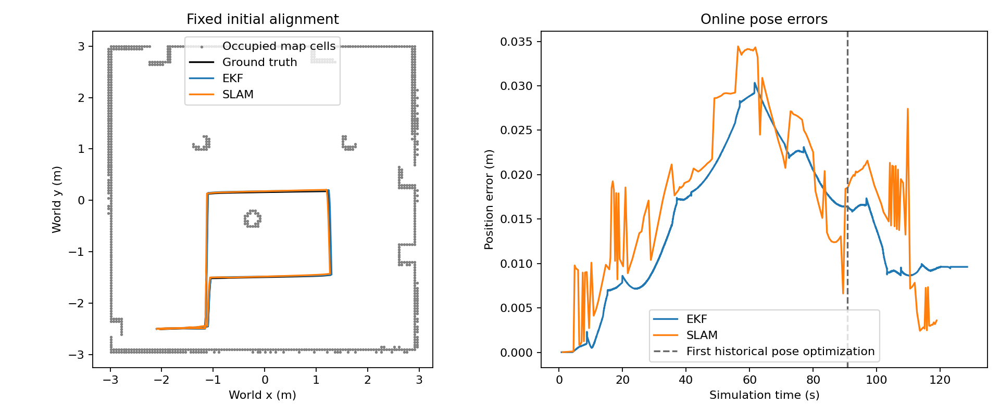

# Workshop mapping with SLAM Toolbox

Issue #136 builds an occupancy map from the UART A1 driver, wheel encoders
and calibrated IMU. Issue #148 supplies `/scan/slam`: a fixed angular grid
with endpoints deskewed through odometry TF. The raw clockwise `/scan`
remains available for diagnostics and the collision guard. Neither mapping
nor the recorded route consumes ground truth.

## Interactive mapping

```console
source /opt/ros/jazzy/setup.bash
python -m colcon build --symlink-install --packages-select robocell_sim
source install/setup.bash
ros2 launch robocell_sim mapping.launch.xml
```

Drive with the control panel. RViz uses `map` as its fixed frame and receives
the occupancy map on `/map`. Mapping starts the simulator, drivers, EKF,
robot description and asynchronous SLAM Toolbox on simulated time. AMCL is
not started. There is one transform owner for each link:

| Transform | Owner |
| --- | --- |
| `map -> odom` | SLAM Toolbox |
| `odom -> base_footprint` | EKF |
| `base_footprint -> base_link -> base_scan` | robot_state_publisher |

The workshop's static `world -> odom` publisher is disabled. MuJoCo `world`
and `/ground_truth/odom` remain diagnostic references; they are not parents
of the mapping TF tree. The lidar frame stays `base_scan`.

After stopping the robot, save the current occupancy map in another terminal:

```console
source /ws/install/setup.bash
ros2 run nav2_map_server map_saver_cli -f /tmp/workshop \
  --fmt pgm --mode trinary --free 0.196 --occ 0.65 \
  --ros-args -p use_sim_time:=true -p save_map_timeout:=8.0
```

This creates `/tmp/workshop.pgm` and `/tmp/workshop.yaml`. The YAML contains
the image path, resolution, map origin and occupancy thresholds. Keep both
files together. A `.posegraph`/`.data` pair saved with
`/slam_toolbox/serialize_map` is a separate SLAM session; it does not replace
these occupancy files for AMCL.

## Load the supplied map

The package installs a map recorded from the route below at
`share/robocell_sim/maps/workshop.yaml`. To inspect it without SLAM, stop the
mapping launch, then start `map_server`:

```console
source /ws/install/setup.bash
ros2 run nav2_map_server map_server --ros-args \
  -p yaml_filename:="$(ros2 pkg prefix --share robocell_sim)/maps/workshop.yaml"
```

Configure and activate it from another terminal:

```console
source /ws/install/setup.bash
ros2 lifecycle set /map_server configure
ros2 lifecycle set /map_server activate
ros2 service call /map_server/map nav_msgs/srv/GetMap '{}'
```

This loads and publishes a map; it does not localize the robot. AMCL and
navigation remain separate tasks. The recorded verification loads the saved
map on `/verification/map` while SLAM continues to own `/map`, checks every
cell against the saved image and checks the saved origin and resolution.

## Reproduce the mapping route

Use an unused SocketCAN channel and a fresh output directory:

```console
source /opt/ros/jazzy/setup.bash
source install/setup.bash
python docs/mapping/record.py log/mapping-136/verification --domain 91
python docs/mapping/analyze.py log/mapping-136/verification
```

`--channel` selects the CAN channel. The script refuses an existing output
directory or traffic on that channel. It starts the headless mapping stack
with RViz and keyboard control disabled, seed 422 and drive IDs 17 and 29.
It waits for the motor driver, gyro calibration, scans, odometry and a map.
All startup, service, motion, pause/resume and shutdown waits are bounded.

[route.json](route.json) describes the fixed route in `odom`. A proportional
command follows each specified waypoint using `/odometry/filtered`, then
turns to the final heading. This is a diagnostic route, with no obstacle
planner or ground-truth feedback. The collision guard remains active. The
route starts beside the dock, moves east around the low pallet, passes north
along the west side of the central column, crosses east, turns south, and
returns west to rejoin its earlier path before going back to the dock. It
covers about 12 m in this scene. The script then pauses and resumes the
simulation, saves the occupancy map and the separate pose graph, and loads
the occupancy map through the installed Nav2 map server.

The recording contains `/scan`, `/scan/slam`, `/clock`, `/map`, `/tf`,
`/tf_static`, wheel odometry, filtered odometry, `/pose`, ground truth,
commands, readiness states, SLAM graph markers and the reloaded map. It
retains launch logs, exact route/configuration, checks and a bag digest.
`export.cpp` reads the saved graph through the installed Karto API, retaining
node IDs, acquisition times, corrected poses and constraints in `graph.json`.
The recorder compiles it locally using the ROS development headers, Eigen,
Boost serialization and TBB already supplied by the development image.

## Evaluation

The map/world alignment is fixed before the route from the initial workshop
pose, without fitting estimated trajectories to truth:

```text
world_x   = -2.1 - map_y
world_y   = -2.5 + map_x
world_yaw = map_yaw + pi/2
```

Ground-truth XY positions are interpolated at the estimate timestamp;
headings use unwrapped interpolation. Both online SLAM poses and the final
optimized graph are compared with this fixed alignment. Online poses retain
what was published at the time; they are not retrospectively corrected
when a later loop optimizes historical nodes.

Loop evidence includes constraints between scan IDs separated by at least
40 processed scans and revisions of previously published node positions in
later graph snapshots. The latter distinguishes actual graph optimization
from a closed driving path or a new local connection. `constraints.json`
retains the nonlocal links; the separate serialized graph retains their
final endpoints. No manual graph edits or truth-derived corrections are
used.

The compact workshop needs separate local-link and loop-search scales.
`use_scan_barycenter=false` uses the robot's scan pose rather than the centroid
of returns, which can stay near the room center while the robot drives.
`link_scan_maximum_distance=0.4` and `loop_search_maximum_distance=1.2` keep a
revisited part of the route outside the immediately linked neighborhood.
The original 3 m search neighborhood treated this short route as local and
did not revise historical graph poses. Acquisition/TF timing was verified
before changing these settings.

The map diagnostic transforms occupied-cell centers into world and measures
their distance to the nearest static box or cylinder surface intersecting
the 0.132 m scan plane. It excludes the low pallet, which the lidar cannot
see. The residual includes rasterization at 5 cm resolution and does not
measure completeness of unseen areas. It is not an AMCL accuracy test.

The accepted 11.73 m route took about 120 s of simulated driving. SLAM
produced 193 graph nodes and 219 constraints. Historical-node positions
changed at 90.81 s and 110.73 s; the maximum final correction relative to
previously published poses was 1.13 cm. The final graph includes a link back
to node 0. Map saving and Nav2 reload preserved all 14,520 cells and the
saved origin. Raw scan age during startup and driving stayed between
0.187 s and 0.239 s.

| Measurement | Result |
| --- | --- |
| Online SLAM position RMSE | 1.98 cm |
| Online SLAM position 95th percentile | 3.39 cm |
| Final SLAM position error | 0.36 cm |
| Online SLAM heading RMSE | 0.37 degrees |
| Final optimized-graph position RMSE | 2.07 cm |
| Occupied-cell distance to surfaces, median / 95th percentile | 3.8 / 8.8 cm |
| Saved map | 120 by 121 cells, 0.05 m resolution |



The optimized graph's mean position error did not improve over the online
poses on this short route. A small final error does not imply that drift
was removed throughout the route. The endpoint was about 6.3 cm from its
true starting position because the diagnostic command finishes within a
6 cm odometry tolerance and odometry itself has error.

Measured results and the selected map's provenance are recorded in
[results.json](results.json). The saved map uses a fixed initial gauge and
is tied to this workshop scene. Estimated acquisition timestamps, odometry
errors, angular binning and planar motion compensation remain limitations.
SLAM can correct scan-consistent drift; this does not establish that bias,
wheel calibration or localization errors disappear.
